<div align="center">

<p align="center">
  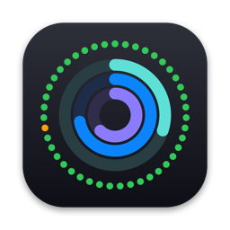
  <br>
  
</p>

A native menu bar app for your Mac that watches your home server:<br>
vitals, containers and alerts in one Liquid Glass popover.

<br>

<a href="https://github.com/adrbn/pulse/releases/latest/download/Pulse.dmg"></a>&nbsp;&nbsp;
<a href="https://ko-fi.com/adrbn">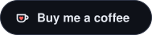</a>

<a href="#four-styles">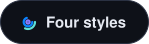</a>&nbsp;&nbsp;
<a href="#connect-a-server"></a>

<br>

<a href="https://github.com/adrbn/pulse/releases/latest"></a>

<br>

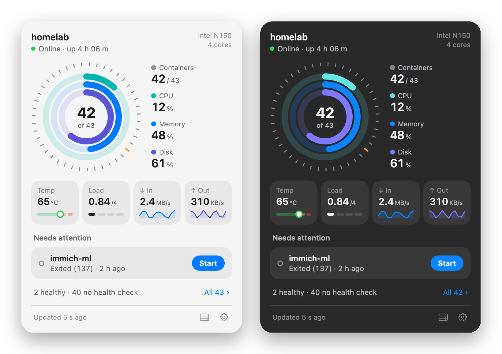

<sub>Every screenshot uses built-in mock data.</sub>

<br><br>


Your dashboard lives in a browser tab you never open.<br>
**Pulse lives in the menu bar.** One ring says all is well.<br>
When a container dies, a notification shows up with a **Start** button.

<br>

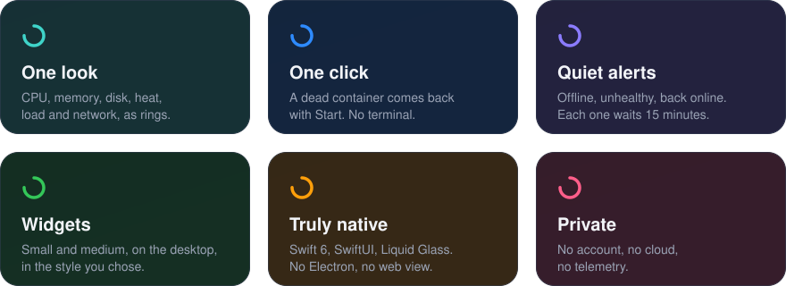

<br><br>

<a id="four-styles"></a>


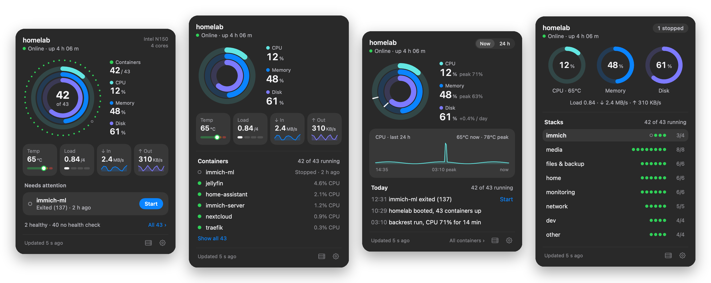

**Halo** circles the vitals with your containers &nbsp;·&nbsp; **Rings** puts vitals first<br>
**Memory** replays the last 24 hours &nbsp;·&nbsp; **Live** shows every Compose stack

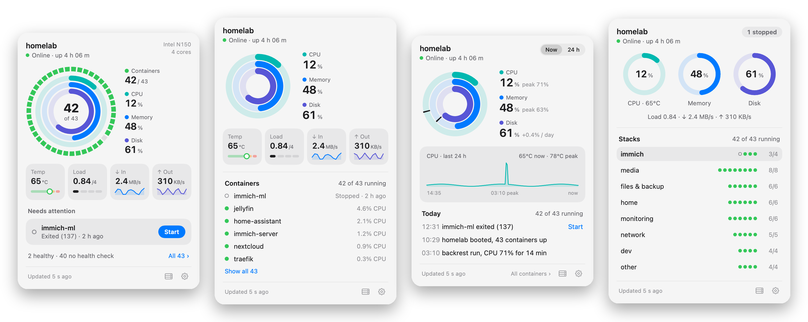

<br><br>


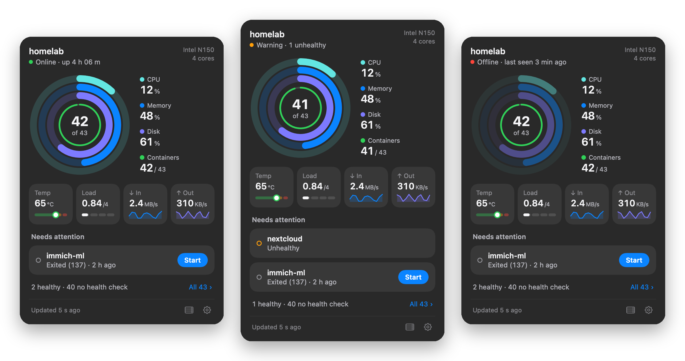

<br><br>


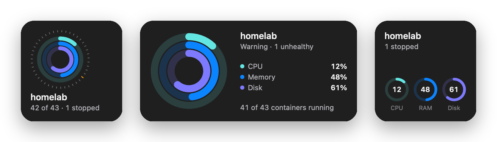
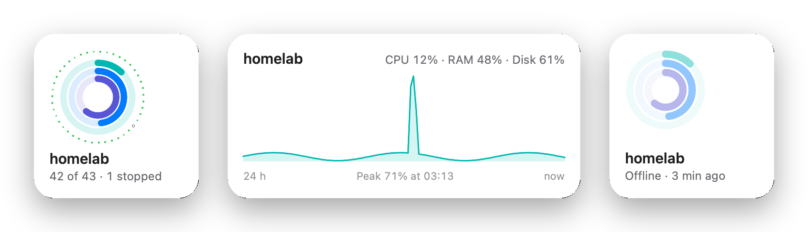

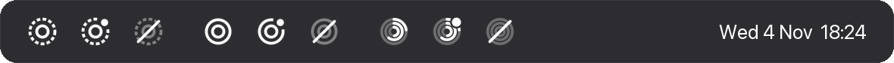

<br><br>

<a id="install"></a>


</div>

1. **[Download Pulse.dmg](https://github.com/adrbn/pulse/releases/latest/download/Pulse.dmg)**, signed and notarized by Apple.
2. Drag **Pulse** into **Applications** and open it. It lives in the menu bar, not the Dock.
3. Right click the icon, choose **Settings…**, and connect your server.

Requires macOS 26 or later. Left click the icon for the popover; right click for **Refresh** ⌘R, **Settings…** ⌘, and **Quit** ⌘Q.

<div align="center">

<br>

<a id="connect-a-server"></a>


</div>

| | You enter | You get |
|---|---|---|
| **[Beszel](https://beszel.dev)** · recommended | Hub URL, email, password, system name | CPU, memory, disk, temperature, load, network, running containers |
| **Proxmox VE** | API URL, node, API token with `Sys.Audit` | The same, without temperature |
| **Docker** · optional, with either | `http://your-server:8772` | Stopped containers, exit codes, the **Start** button |

Beszel doesn't see stopped containers, and **Start** needs the Docker Engine API. The socket proxy in
[`deploy/docker-socket-proxy.yml`](deploy/docker-socket-proxy.yml) is locked down to list, inspect and start, from one IP.

<details>
<summary><b>When does Pulse turn orange or red?</b></summary>

<br>

| State | When |
|---|---|
| **Offline** | No answer for 60 s. Alert after 3 minutes. |
| **Warning** | An unhealthy container, CPU above 90 % for 5 minutes, memory above 90 %, disk above 85 %, temperature above 85 °C. Stopped containers too, if you turn that on. |
| **Critical rings** | CPU 98 %, memory 95 %, disk 95 %. |

</details>

<details>
<summary><b>Privacy</b></summary>

<br>

Pulse talks to the servers you enter and nowhere else. Passwords and tokens stay in the macOS Keychain.
No account, no analytics, no update server.

</details>

<details>
<summary><b>Build from source</b></summary>

<br>

```bash
brew install xcodegen
git clone https://github.com/adrbn/pulse && cd pulse
xcodegen generate
xcodebuild -project Pulse.xcodeproj -scheme Pulse -configuration Release -derivedDataPath build/dd build
```

Set `DEVELOPMENT_TEAM` in `project.yml` and the App Group in the entitlements to your own team.
Tests: `cd PulseKit && swift test`. Render every style, state and widget as PNG with
`Pulse.app/Contents/MacOS/Pulse --render-snapshots ~/Library/Containers/dev.adrbn.pulse/Data/tmp/snaps`.

</details>

<div align="center">

<br>


If Pulse saves you a trip to the dashboard, a coffee keeps it going.

<a href="https://ko-fi.com/adrbn"></a>

<br><br>

<sub>MIT License · © Adrien Robino</sub>

</div>
